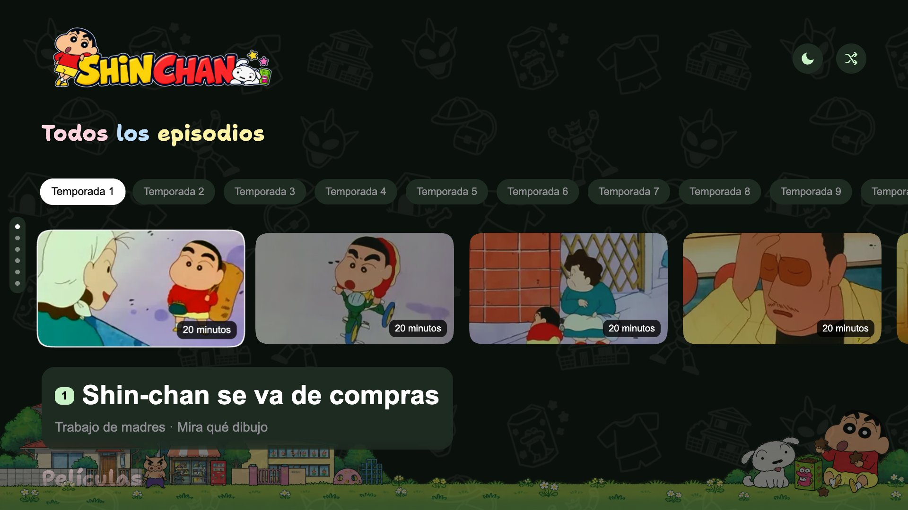
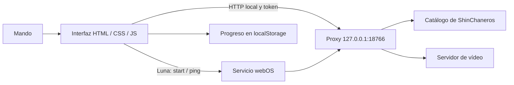

# Shin-Chan TV

**Temporadas, películas y un rincón de Kasukabe en tu tele LG.**

Aplicación personal para **LG webOS TV** que consulta el catálogo de [ShinChaneros](https://shinchaneros.tv). Interfaz en español, navegación con mando, progreso local y una estética oscura con personajes, colores pastel y objetos de Shin-chan.

[](https://github.com/jesusjodar/Shin-Chan-TV/actions/workflows/ci.yml)  

Proyecto de [@jesusjodar](https://github.com/jesusjodar). No oficial y sin afiliación con ShinChaneros, LG ni los titulares de Shin-chan.

## Índice

1. [Qué incluye](#qué-incluye)
2. [Requisitos](#requisitos)
3. [Instalación](#instalación)
4. [Uso con el mando](#uso-con-el-mando)
5. [Personalización](#personalización)
6. [Iconos y recursos](#iconos-y-recursos)
7. [Cómo funciona](#cómo-funciona)
8. [Estructura del proyecto](#estructura-del-proyecto)
9. [Pruebas y contribuciones](#pruebas-y-contribuciones)
10. [Problemas frecuentes](#problemas-frecuentes)
11. [Créditos y aviso](#créditos-y-aviso)

## Qué incluye

| Función | Comportamiento |
| --- | --- |
| Catálogo | Episodios por temporada, películas, favoritos, especiales, viajes en familia e historias de miedo. |
| Inicio | Foco en el primer episodio de la primera temporada, sin iniciar la reproducción. |
| Seguir viendo | Recupera el último título y su posición guardada. |
| Reproductor | Pausa, saltos de 30 segundos, búsqueda temporal, siguiente episodio y reproducción aleatoria. |
| Progreso | Guardado local por título; episodios y películas tienen claves distintas. |
| Duraciones | Lectura de metadatos MP4 por rangos, con dos consultas simultáneas como máximo. |
| Foco | Anillo blanco fino, botones circulares en el reproductor y zoom del 4 %. |
| Desplazamiento | Movimiento suave entre filas, tarjetas y temporadas. |
| Carga | Personaje girando sobre negro desde el HTML inicial. |
| Accesibilidad | Etiquetas para controles, foco visible y respeto de `prefers-reduced-motion`. |



Vista de la interfaz con el catálogo de pruebas, sin historial personal.

**Modo dormir:** intenta aplicar imagen Expert 2, brillo 25, volumen 5 y apagado en dos horas. Necesita las funciones de ejecución de Homebrew Channel y los ajustes compatibles de la TV. Modifica ajustes reales de imagen, volumen y temporizador; al desactivarlo vuelve a Vivid y brillo 100, y cancela ese temporizador.

## Requisitos

- LG webOS TV con posibilidad de instalar aplicaciones: Developer Mode o un entorno Homebrew compatible.
- Conexión a Internet en la TV para consultar catálogo, miniaturas y vídeos.
- En el ordenador: **Node.js 20 o posterior**, npm y el [CLI oficial de webOS](https://github.com/webos-tools/cli).
- Bash para los scripts de empaquetado e instalación; en Windows puedes usar Git Bash o ejecutar los comandos `ares-*` directamente.

La interfaz está diseñada para **1920 × 1080**. La versión de Chromium y las APIs disponibles cambian según el modelo y la [versión de webOS](https://webostv.developer.lge.com/develop/specifications/web-api-and-web-engine). No se garantiza compatibilidad con todos los modelos ni una tasa fija de fotogramas.

## Instalación


### 1. Obtener el proyecto y el CLI

```sh
git clone https://github.com/jesusjodar/Shin-Chan-TV.git
cd Shin-Chan-TV
npm install --global @webos-tools/cli@3.2.6
```

La app no necesita instalar dependencias npm para funcionar. El módulo `webos-service` lo proporciona la TV.

### 2. Registrar la TV

```sh
ares-setup-device
ares-setup-device --list
```

Añade tu TV con un nombre, por ejemplo `tv`, y los datos de conexión de tu entorno. Si usas Developer Mode, sigue la [guía oficial de LG](https://webostv.developer.lge.com/develop/getting-started/developer-mode-app) para activar el servicio y obtener la clave con `ares-novacom --device tv --getkey`.

En un entorno root, usa la conexión SSH que ya tengas configurada. No añadas claves, contraseñas ni direcciones de tu red al repositorio.

### 3. Comprobar y empaquetar

```sh
npm run check
npm test
npm run package
```

El paquete se genera en `dist/` e incluye **la interfaz y el servicio**. Empaquetar conserva los archivos que ya haya en esa carpeta.

### 4. Instalar y abrir

```sh
TV_DEVICE=tv npm run install-tv
```

`TV_DEVICE` es el **nombre registrado en `ares-setup-device`**, no la dirección IP. Si se omite, se usa `tv`. El script instala el paquete más reciente de `dist/` y abre `com.shinchaneros.tv`.

Para elegir un paquete concreto:

```sh
TV_DEVICE=tv npm run install-tv -- dist/com.shinchaneros.tv_1.1.1_all.ipk
```

Comandos equivalentes sin Bash:

```sh
ares-package app service -o dist
ares-install --device tv dist/com.shinchaneros.tv_1.1.1_all.ipk
ares-launch --device tv com.shinchaneros.tv
```

## Uso con el mando

| Control | Catálogo | Reproductor |
| --- | --- | --- |
| Izquierda / derecha | Recorrer tarjetas, temporadas y acciones. | Recorrer los controles. |
| Arriba / abajo | Cambiar de fila; desde la primera fila, subir a temporadas. | Buscar hacia delante o atrás: empieza en 15 s y aumenta con pulsaciones rápidas. |
| OK | Elegir temporada o reproducir el título enfocado. | Activar el control enfocado. |
| Atrás | Salir de la app. | Volver al catálogo. |
| Reproducir / pausar | El botón Reproducir abre la tarjeta seleccionada. | Controlar la reproducción. |
| −30 s / +30 s | — | Saltar treinta segundos. |
| Siguiente | — | Avanzar en la colección; en episodios puede cargar la siguiente temporada. |

**Seguir viendo** conserva el título anterior aunque el catálogo abra en T1 · E1. El historial se guarda en `localStorage`, con la clave `shinchan-tv-v1`. No hay sincronización con cuentas ni con otros dispositivos.

## Personalización


| Quiero cambiar… | Archivo o punto de entrada |
| --- | --- |
| Paleta pastel | `PASTEL_SETS` en [`app/app.js`](app/app.js). |
| Espaciado, tamaños y foco | [`app/style.css`](app/style.css); anillo de tarjetas en `#focus-outline` de [`app/index.html`](app/index.html). |
| Fondo y marco inferior | `app/assets/patron-shinchan.png` y `marco-kasukabe-v2.png`. |
| Personajes de carga | `loadingAssets` en `app/app.js` y sus PNG en `app/assets/`. |
| Logo y tipografías | `logo-shinchan-decorado.png`, fuentes `crayon-*.woff2` y reglas `@font-face`. |
| Filas y colecciones | `initShelves()` y `drawShelf()` en `app/app.js`. |
| Iconos del launcher | `app/icon.png`, `app/largeIcon.png` y el recurso panorámico explicado abajo. |
| Parser del proveedor | [`service/catalog.js`](service/catalog.js) y las fixtures de pruebas. |

Para trabajar con un agente, empieza por [AGENTS.md](AGENTS.md). Describe la parte de la interfaz que quieres cambiar y conserva los identificadores y la clave de progreso salvo que hayas preparado una migración.

### Grosor del foco

El grosor actual es **2 px**. Para cambiarlo, mantén sincronizados `--focus-width` en CSS y `radius` de `feMorphology` en el filtro SVG compartido. Los controles del reproductor tienen un anillo sobre el botón circular; el filtro no se aplica a sus glifos.

## Iconos y recursos

<p>
  
  
</p>

| Recurso | Tamaño | Uso |
| --- | --- | --- |
| [`app/icon.png`](app/icon.png) | 80 × 80 · 1:1 | Icono declarado en `appinfo.json`. |
| [`app/largeIcon.png`](app/largeIcon.png) | 130 × 130 · 1:1 | Icono grande declarado en `appinfo.json`. |
| [`icon.jpg`](icon.jpg) | 1254 × 1254 · 1:1 | Recurso cuadrado de alta resolución. |
| [`icon-wide.jpg`](icon-wide.jpg) | 1920 × 1080 · 16:9 | Recurso panorámico para launchers personalizados. |
| [`app/banner-16x9.png`](app/banner-16x9.png) | 1920 × 1080 · 16:9 | La tarjeta panorámica de Nevado en PNG. |
| [`docs/images/`](docs/images/) | Varios | Banners de esta documentación y fuente del icono. |

El archivo panorámico es un recurso para integrar en un launcher; su presencia no obliga al launcher nativo de LG a usar un formato 16:9. En Project Hiten, el identificador que debe asociarse a la tarjeta es **`com.shinchaneros.tv`**.

## Cómo funciona



El servicio consulta páginas y datos públicos, extrae enlaces MP4 y transmite el vídeo conservando las peticiones **Range** y el **Referer** del proveedor. Los vídeos no se guardan en archivos; el catálogo y las duraciones se cachean en memoria. El frontend también conserva las duraciones consultadas y el progreso en su almacenamiento local.

El servidor escucha en la interfaz de loopback y requiere un token aleatorio por ejecución. `Access-Control-Allow-Origin: *` permite a la app empaquetada consultar ese servidor; no es una lista de sitios autorizados ni sustituye al token.

| Ruta local | Datos |
| --- | --- |
| `/seasons` | Temporadas disponibles. |
| `/episodes/:temporada` | Episodios de una temporada. |
| `/collection/:id` | `movies`, `favorites`, `specials`, `travel` o `fear`. |
| `/resolve/:clave` | Resuelve una clave de episodio o película a una ruta local de vídeo. |
| `/video/:clave` | Transmisión del MP4. |
| `/duration/:clave` | Duración y metadatos disponibles. |

La clave de un episodio es `temporada/id`; la de una película es `movie/slug`. La app solicita el arranque mediante `luna://com.shinchaneros.tv.service/start` y renueva la actividad con `ping`.

## Estructura del proyecto

```text
Shin-Chan-TV/
├── app/                 Interfaz, manifiesto e iconos webOS
│   └── assets/          Imágenes, fuentes y metadatos complementarios
├── service/            Catálogo, proxy, UTF-8 y metadatos MP4
├── tests/              Pruebas automáticas y sondas para la TV
│   └── fixtures/        Muestras del proveedor para pruebas sin Internet
├── scripts/            Empaquetado e instalación mediante ares
├── docs/               Banners, prompts y aviso del proyecto
├── .github/workflows/  Comprobaciones automáticas
├── AGENTS.md           Guía para agentes y personalizaciones
└── package.json        Comandos del proyecto
```

`dist/` se genera al empaquetar y está excluida de Git. El repositorio no incluye credenciales ni configuración de una TV concreta.

## Pruebas y contribuciones

```sh
npm run check
npm test
```

Las pruebas automáticas cubren catálogo, colecciones, rechazo de datos inválidos, cabeceras MP4, caracteres UTF-8 partidos entre paquetes, arranque, consultas de duración, geometría e instalación simulada. No necesitan la TV ni reproducen vídeo.

GitHub Actions ejecuta esas comprobaciones y genera un IPK en cada cambio de `main` o pull request.

Las sondas `tests/tv-layout.js`, `tv-navigation.js`, `tv-motion.js` y `tv-focus.js` se ejecutan en la consola del inspector de la app en la TV. Cambian temporalmente el foco o la vista para comprobar la interfaz y restauran el estado visual al terminar. `tv-focus.js` valida los seis controles circulares del reproductor sin abrir un vídeo.

Para contribuir:

1. Lee [AGENTS.md](AGENTS.md) y localiza el punto que quieres cambiar.
2. Mantén el cambio acotado y añade una prueba si cambia navegación, parsers o manejo de errores.
3. Ejecuta las comprobaciones y, si cambia la interfaz, verifica foco, mando y movimiento reducido.
4. Abre una pull request explicando el cambio y cómo lo has probado.

## Problemas frecuentes

| Problema | Qué comprobar |
| --- | --- |
| No aparece el catálogo | Conexión de la TV, disponibilidad del proveedor y que se haya instalado el servicio junto con la app. |
| No conecta el instalador | El nombre en `TV_DEVICE`, la configuración de `ares-setup-device` y las credenciales de tu entorno. |
| «No hay .ipk» | Ejecuta `npm run package` o pasa la ruta del paquete que quieres instalar. |
| Duración «—» | El proveedor todavía no ha respondido o el MP4 no permite leer esa cabecera por rango. |
| Una colección falla | Usa su tarjeta de reintento; las otras filas pueden seguir disponibles. |
| Modo dormir no funciona | Ejecución privilegiada de Homebrew Channel y nombres de ajustes compatibles con tu modelo. |
| Se pierde el progreso | Borrar datos o desinstalar puede eliminar el almacenamiento. Mantén el ID al actualizar y guarda una copia antes de migrarlo. |
| El parser deja de funcionar | El proveedor puede cambiar su HTML o sus archivos de datos: actualiza el parser y las fixtures. |

## Créditos y aviso

Aplicación y mantenimiento: **[@jesusjodar](https://github.com/jesusjodar)**. Los banners y varias ilustraciones se han creado con generación de imágenes tomando como referencia los assets de la app; sus prompts están en [docs/ARTE.md](docs/ARTE.md).

El catálogo y el vídeo dependen de ShinChaneros y sus servidores; los datos complementarios y pósters incluyen material de TMDB. Las marcas, personajes y demás recursos de terceros pertenecen a sus titulares. El proyecto no declara una licencia general que cubra esos recursos.

Consulta [el aviso del proyecto](docs/AVISO-LEGAL.md). La disponibilidad del proveedor y la compatibilidad de cada TV quedan fuera del control de esta app.
